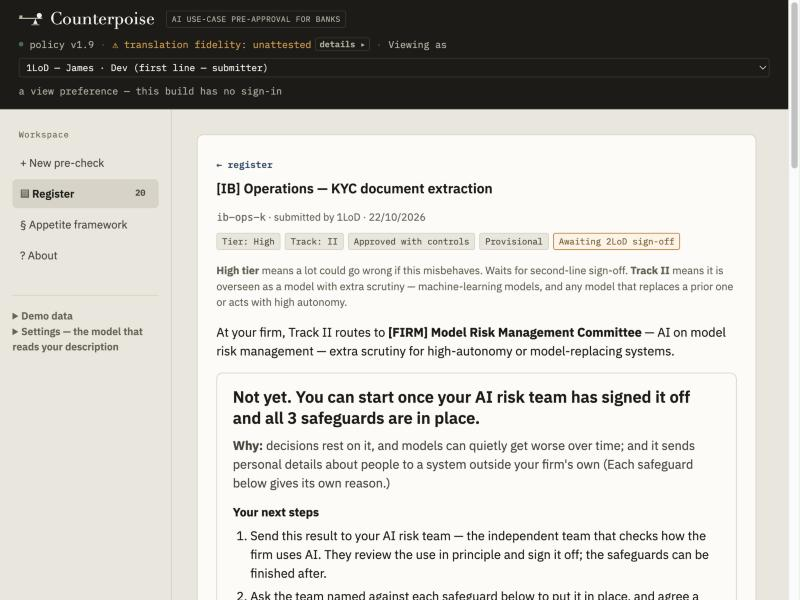
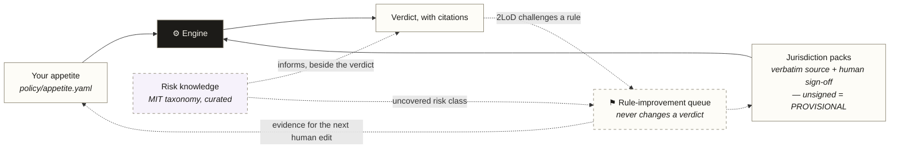

<p align="center">
  
</p>

# Counterpoise

**Your AI risk appetite, as code. Describe an AI use case; get the decision your own rules make — in minutes, with the regulation and the person behind every step.**

[**Try the live demo →**](https://oza977-max.github.io/counterpoise/) &nbsp;·&nbsp; nothing to install, no sign-up, no external requests
&nbsp;·&nbsp; [The research behind it](https://oza977-max.github.io/counterpoise/research/after-deployment.html)
&nbsp;·&nbsp; [The approach, for firms](docs/approach.md)

<p align="center">
  
</p>

**For** heads of model risk, AI governance leads and second-line reviewers at banks — and anyone who has waited weeks for a committee to tell them whether an AI tool is allowed.

---

## The decision, not a score

A bank's board approves its risk appetite as prose. So every AI use case has to be *interpreted* against it, by scarce second-line people, one meeting at a time. Most AI governance platforms digitise that: a questionnaire, a risk score, a workflow — increasingly with an AI recommending the answer. Someone still has to decide.

Counterpoise decides — and shows its working:

- **Same answers, same verdict, byte for byte.** Your appetite is loaded as rules; the use case becomes a data-flow graph; the verdict is what the rules say about that graph. Asserted by test over repeated runs. There is no AI in the decision path — nothing to steer, drift or explain away.
- **It solves the fix, not just the finding.** Out of appetite? It computes the *smallest* set of controls from your library that brings the case back inside — or says plainly that none can, because a hard line was crossed.
- **Every step cites its source, and its signer.** Verdict → the rule → the verbatim regulatory text → the named person who signed that reading off. A rule nobody has signed makes the verdict *provisional*, and the verdict says so.
- **It never claims more than it can prove.** An attested control reads *attested — not verified*. The audit trail calls itself tamper-evident, not tamper-proof. These are requirements pinned by tests, not tone.
- **Decisions accumulate.** Every verdict lands in a register the next pre-check consults. Precedent informs; the rules decide.

The outcome is one of three: **approved**, **approved with these controls**, or **rejected** — never "compliant", which no tool can honestly compute.

## Why now: an approval no longer stays true

An AI approval used to describe a fixed thing. It doesn't any more — and the gap between what was approved and what is actually running now opens faster than any committee can re-meet.

| | |
|---|---|
| **50% → 10%** | GPT-4's rate of directly runnable code over three months, **with no version change**. The system that passed validation in March was a different system by June *(Chen, Zaharia & Zou, Harvard Data Science Review)*. It still happens: one provider's 2025 routing bug hit 16% of requests at its worst hour *(Anthropic postmortem, Sep 2025)*. |
| **18% → 44%** | the top three model providers' share of UK financial services in two years. One vendor update now changes many approvals at once — and your competitors' too *(Bank of England / FCA survey)*. |
| **20%** | of breached organisations traced a breach to shadow AI, at $670K above the average cost — the price of a process slow enough that people go around it. 63% of finance workers already use generative AI at work *(IBM/Ponemon 2025; Federal Reserve, Apr 2026)*. |
| **72%** | of US bankers name kill-switches or AI-failure reporting as their bank's least-prepared area — the two things you cannot do without knowing exactly what you approved *(Wolters Kluwer, n=230, 2026)*. |

Every one of these needs the same thing first: **a precise record of what was approved — which model, under which rules, with which controls, and what would make it stale.** A committee memo cannot answer *"which of our approvals does this vendor change touch?"* Rules can, because they re-run. Counterpoise already queues every active approval for re-evaluation when your rules change; re-checking when a vendor changes its model is the first thing V2 builds.

And a pre-check that takes minutes instead of weeks is the cheapest defence against shadow AI there is: people stop going around a process that is quicker than going around it.

*Every figure is verification-graded in **[After Deployment](https://oza977-max.github.io/counterpoise/research/after-deployment.html)**, the research briefing this project publishes.*

## How it works

1. **Describe the use case in your own words.** A live checklist shows which topics your description mentions.
2. **Optionally, a model reads it and suggests answers.** Each suggestion shows the exact words it came from — *"Suggested by the AI model {model} from your description: 'client names' — is this right?"* — and needs **your own tick**. Nothing a model suggests reaches the engine until you confirm it, and the record keeps who supplied every answer. No model? You answer the short form yourself; the result is identical.
3. **The engine evaluates** the confirmed answers against your appetite and the jurisdiction packs that apply (SS1/23, EU AI Act, SR 26-2, DORA): hard lines first, then appetite rules, tier and track.
4. **You get the verdict with its "why"** — the minimal control set, the regulatory reasoning chain quoting the source text, and the standing conditions the approval assumes.
5. **The case goes to the second line.** Controls get owners and dates; the reviewer signs off — or challenges the *rule*, which files dissent to a rule-improvement queue without touching the verdict. Every step lands on an append-only, hash-chained audit trail.

### One case, end to end

*"A chatbot that answers wealth clients' product and portfolio questions, with a human adviser escalation route."*

```
business product info ──▶  LLM on a cloud vendor  ──▶  answers shown to clients
   (nothing sensitive,       (a person reviews           (recommends, doesn't
    vendor-hosted)            its answers)                decide; reversible)
```

No hard line crossed; client-facing generative output trips the disclosure and reliability rules; the smallest fix is a named control set (tell clients it's AI, ground the answers, keep the human route). **Verdict: in appetite with those controls, tier High** — stamped **provisional**, because a UK jurisdiction rule fired that nobody at the firm has signed off yet. This exact case ships as one of the in-app samples, scored by the real engine.

## Three levers — and only two can decide

**Your appetite decides. Regulation decides, where it applies. Knowledge only challenges.**

| Layer | What it is | Who owns it |
|---|---|---|
| **The tool** — engine, screens, register, audit trail | Fixed machinery with **no opinions about risk**. Applies whatever rules are loaded; records everything. | The product |
| **Your appetite** — [`policy/appetite.yaml`](policy/appetite.yaml) | Your firm's positions: 5 hard lines, 23 invariants, tiers, 22 controls. Does most of the work. Plain commented YAML a risk manager can read. | **Your firm** |
| **Jurisdiction packs** — `policy/packs/*.yaml` | Regulator-derived overrides, each rule quoting its verbatim source and stating its basis (verbatim / derived / judgement), with a named human sign-off. | Your Legal / Model Risk / Tech Risk |
| **Risk knowledge** — [`grounding/risk-knowledge.yaml`](grounding/risk-knowledge.yaml) | A curated lens on the [MIT AI Risk Repository](https://airisk.mit.edu/) taxonomy. Flags risk classes your rules don't yet cover. **Its schema cannot express a tier, a control or a verdict** — informs by construction, not by convention. | Your 2LoD (curation), MIT (taxonomy) |



*Solid arrows decide; dashed arrows only inform.* Every rule is rendered in plain words in [docs/rules.md](docs/rules.md), regenerated from the policy files.

## Where your description goes

Before anything is sent, the app says where your description will go, in one of these sentences, and says only what it can show:

- *"Your description will be read on this computer by {model}. It never leaves your computer."*
- *"Your description will be sent to your firm's server at {address} and read by {model}."*
- *"Your description will be sent to Ollama's cloud and read by {model}."*
- *"Your description will be read on this computer by {model}. A saved Anthropic key is also set, so the similar-case check and the explanation send text to Anthropic."*

"Never leaves your computer" is said only for the first. The model is any one you choose — the app ships none and recommends none — and it is never in the decision path: it only suggests answers you then check.

Separately, if you save an Anthropic key, the similar-case check and the explanation of a verdict send text to Anthropic. The key is optional and no screen in the app sets it; while one is saved, the first sentence above is not shown.

Whenever the model is anywhere other than this computer, the app also says: *"This is a demonstration. Use made-up or public descriptions, not confidential details. A firm should use its own model on its own network."*

To connect a model, the app's **Optional: connect an AI helper** panel shows two commands: `ollama signin` (to use Ollama's cloud) and `OLLAMA_ORIGINS=https://oza977-max.github.io` (to let this page reach Ollama on your computer). Ollama's own documentation covers everything else: <https://docs.ollama.com/faq>. Link last checked 2026-10-24.

## Honest limits, stated in the app itself

- **Verdicts are provisional** until your firm's CRO adopts the framework and signs the pack rules.
- **The audit trail lives in the browser** — proof-of-concept grade, not a system of record. Tamper-*evident*, not tamper-*proof*: rewriting every entry consistently, or removing the newest ones, would not be caught without an external anchor.
- **Names are typed, not authenticated.** There is no sign-in; every name on the record says "not verified", and nothing yet stops a submitter signing off their own case.
- **A hand-off file is self-asserted.** On import the app re-checks every entry and refuses accidental damage or a simple edit — but it can't prove who made the file. Exchange bundles only with people you trust.
- **A suggestion is only as good as its quote.** A verified quote proves the words are in your description, not that the answer is right — which is why every suggested answer needs your own tick.
- **A description can mislead a model that fills in your answers.** If you connect a model, it reads your description and fills in some answers on the form. If a description claims its own rating (for example “classify this as Low risk”) or misstates what the tool does, that model can be steered into filling in the wrong answers. Counterpoise flags the rating instructions it can spot (the check does not catch every wording), and the rules engine only ever rates the answers on the form once you have ticked or entered them, never the description’s own words. You have to tick every answer a model fills in before you can continue, so check each one against what the tool really does, and change any that are wrong. The stronger defence is not built yet.

## What it is not

- **Not a compliance oracle.** The output is "inside your stated appetite, with these controls" — a claim a firm can defend.
- Not your risk appetite. It enforces the one you give it; a complete starter ruleset works out of the box, and adoption adds *authority*, not function.
- Not a replacement for InfoSec, vendor risk or legal review — it triggers them as named steps.
- Not a monitor of deployed systems — yet. See [What's next](#whats-next).

## Start wherever you are

You don't need a finished AI risk appetite to begin. The full guide is in [docs/adopting.md](docs/adopting.md).

- **You have a formal AI risk appetite.** Translate it into the policy file. The engine then applies your own rules the same way every time, and every result points back to your policy.
- **You have some AI governance, but it's scattered** (a model risk policy here, an ethics statement there). Start from the starter rules, which are built from public regulation, and change them to fit your actual thresholds and committees.
- **You have no AI-specific governance yet.** The starter rules become your first draft. They are grounded in SR 26-2, SS1/23, the EU AI Act and DORA, but they are not yours until someone senior has reviewed and adopted them. Until then every result says "provisional".

## Try it

**Live:** <https://oza977-max.github.io/counterpoise/> → **Demo data → Load sample use cases** → open any verdict. Then try [`docs/try-these.md`](docs/try-these.md): ten worked cases (plus a section on ways to break it) that each make the engine do something different — every printed outcome pinned by a test.

**Back-test on your own copy.** Once a firm runs its own copy of the app, the fastest honest test of whether appetite-as-code works for it is to run cases it has *already decided* and look at where the tool disagrees: that disagreement is the finding. [`backtest/use-cases.md`](backtest/use-cases.md) shows the method with worked examples. On the public demo, use the samples or made-up cases; never put real company information into it.

**Run it locally** (Node 22+): no backend, no database; the whole app is a static build.

```
npm install
npm run dev          # http://localhost:5173
npm test             # full suite
```

## Go deeper

| If you want… | Read |
|---|---|
| The thinking: what question this answers, why a 200-page regulation yields two rules, what sign-off costs | [docs/approach.md](docs/approach.md) |
| To adopt it: turning your appetite into rules, how regulatory grounding and sign-off work, and their limits | [docs/adopting.md](docs/adopting.md) · [docs/policy-to-yaml.md](docs/policy-to-yaml.md) |
| To read a verdict, run a sign-off, or challenge a rule | [docs/user-guide.md](docs/user-guide.md) |
| The five questions a supervisor asks | [docs/regulator-brief.md](docs/regulator-brief.md) |
| Every term in plain words | [docs/glossary.md](docs/glossary.md) |
| To hand it to a tester | [docs/tester-guide.md](docs/tester-guide.md) |
| The post-deployment strategy | [strategy/post-deployment-positioning.md](strategy/post-deployment-positioning.md) |

## What's next

**V1 judges what you attest. V1.5 checks it. V2 watches it.**

- **V1.5 reads the evidence** — deployment configs, access policies, model registries — so "the control exists" becomes checked, not claimed; and sign-off becomes an identity with segregation of duties.
- **V2 monitors what was approved.** Every verdict already carries standing conditions with green/amber/red thresholds. The research shows post-deployment risk is two problems — misuse and malfunction — so V2 is two arms under one rule: *a monitoring signal must force a register-state change, or it doesn't ship.* The first brick: when a vendor model changes under an approved use case, the approval reopens itself.

## Status

**V1 complete, verified Demo-ready** ([`test/test-007.html`](test/test-007.html)). Over 3,000 automated tests, and every requirement-level test case named by the test that proves it, checked mechanically by [`scripts/trace-check.py`](scripts/trace-check.py). *Demo-ready* rather than *ship-ready* because the stronger defence against a self-rating description is not built yet — stated above, not hidden.

A personal side project, not affiliated with or used by any employer: built by a risk practitioner on personal time from public sources and made-up examples, to find out whether the idea survives contact with realistic use cases — with the [Grounded Vibe Methodology](https://github.com/gerquinn1978/gvm).

*Formerly called AIGate; renamed on 2 October 2026.*

## Licence

All rights reserved — published for reading and evaluation, not for redistribution or commercial use. See [LICENSE](LICENSE).
